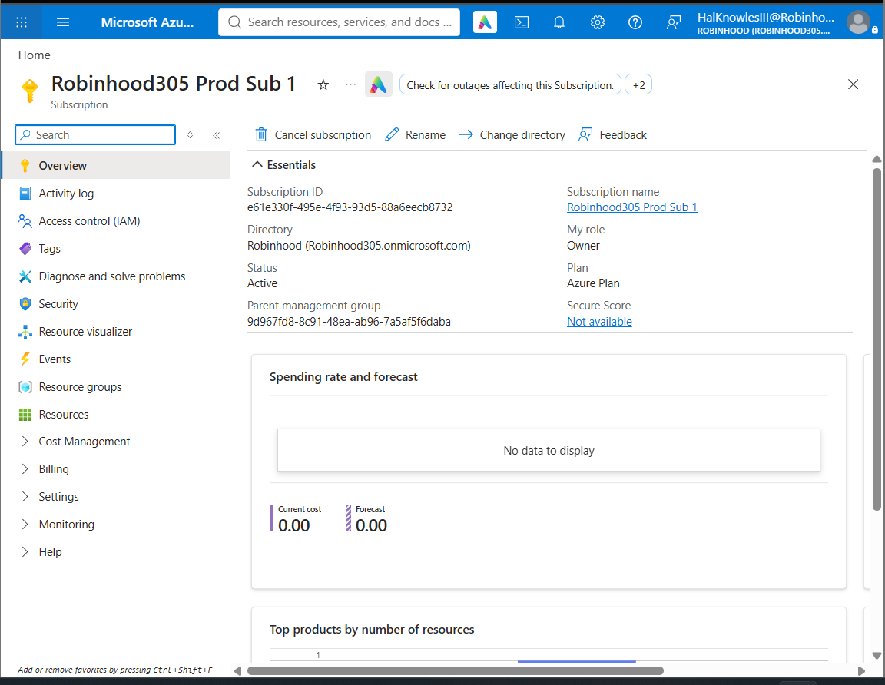
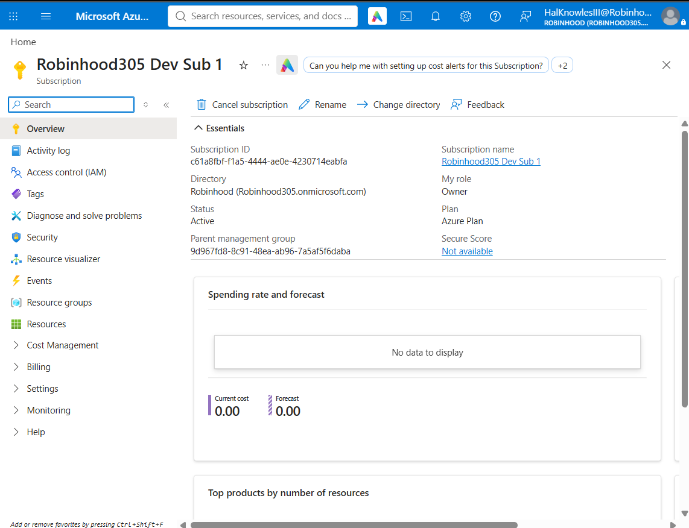
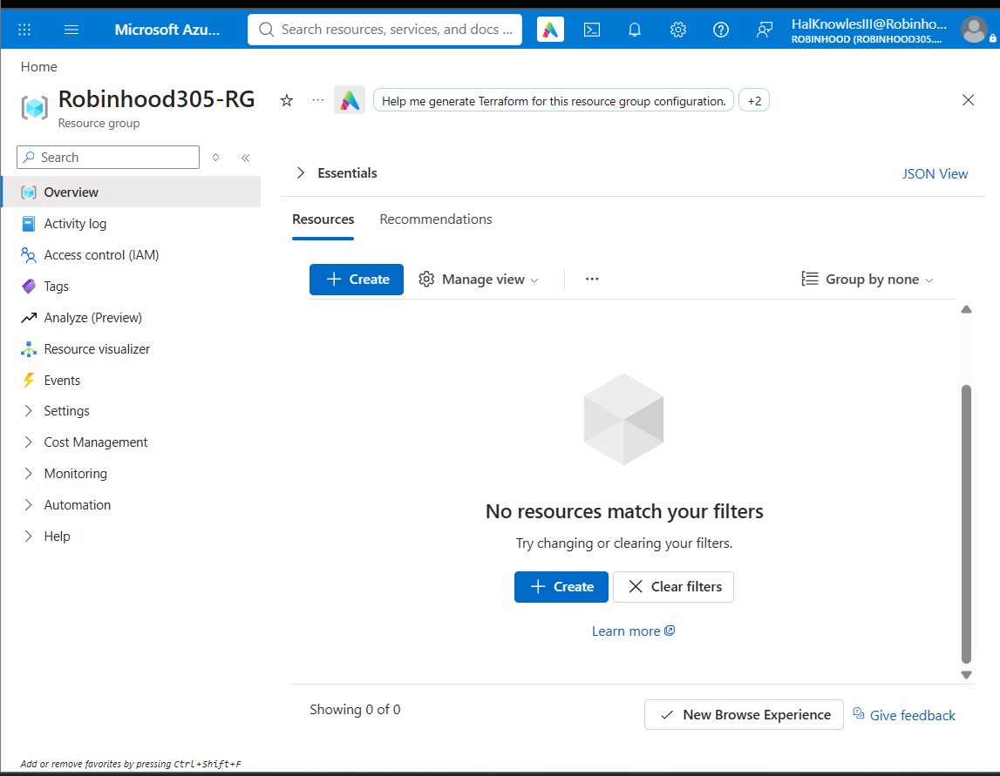
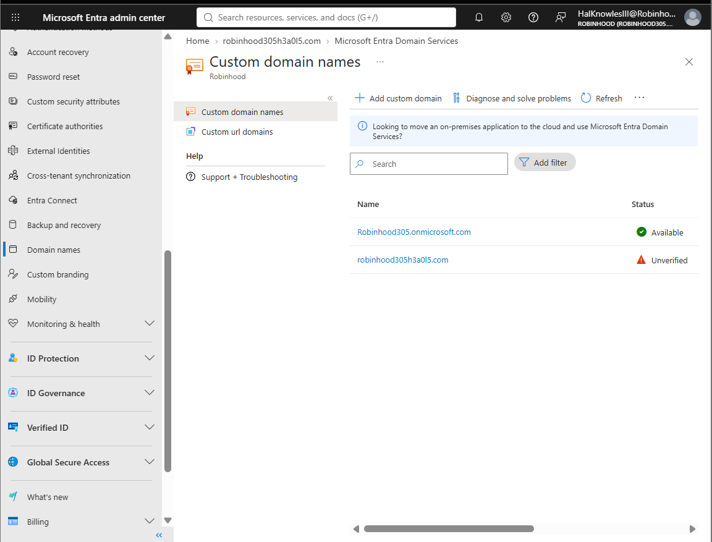
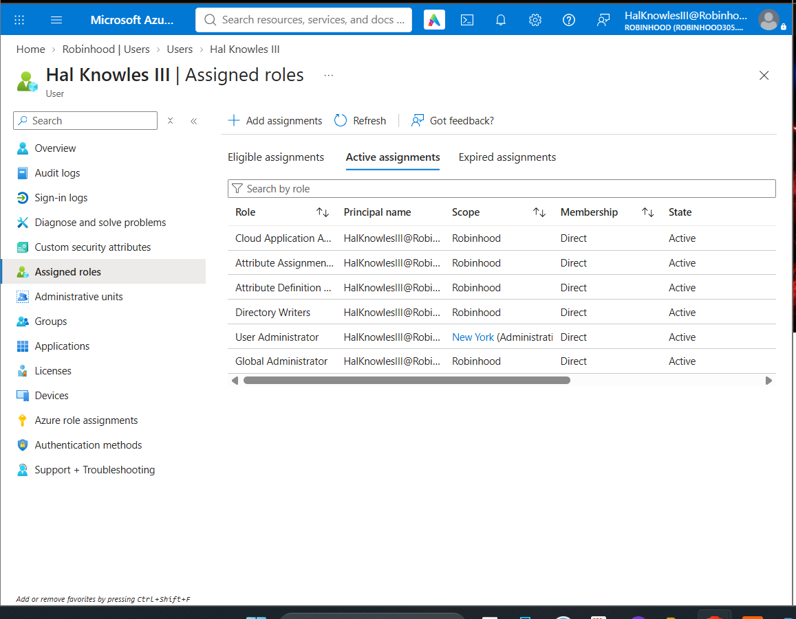

# Lab 1: Multi-Subscription Governance, Custom Domains & Entra ID Administrative Setup

## 🎯 Executive Summary & Objectives
- **Goal:** Establish foundational identity governance, subscription segmentation, and custom domain configuration within Microsoft Azure and Microsoft Entra ID.
- **Organization Name:** Robinhood (`Robinhood305.onmicrosoft.com`)
- **Key Azure Services Used:** Microsoft Entra ID (Azure AD), Azure Subscriptions, Resource Groups, Role-Based Access Control (RBAC).

---

## 🏗️ Architecture & Implementation Summary

In this lab, I configured an enterprise environment separating **Production** and **Development** workloads into distinct subscription boundaries while managing identity governance through Microsoft Entra ID.

### 1. Subscription Segmentation (Prod vs. Dev)
To ensure isolation between production environments and testing workflows, two distinct Azure Subscriptions were provisioned under the primary directory (`Robinhood305.onmicrosoft.com`):

* **`Robinhood305 Prod Sub 1`**: Reserved for live production workloads.
* **`Robinhood305 Dev Sub 1`**: Dedicated sandbox for development, testing, and staging resources.

*Figure 1: Overview of `Robinhood305 Prod Sub 1` attached to the `Robinhood` directory under the Azure Plan.*

*Figure 2: Overview of `Robinhood305 Dev Sub 1` configured for environment isolation.*

---

### 2. Resource Group Organization
A primary Resource Group named **`Robinhood305-RG`** was created to act as a logical container for resources deployed within the subscription ecosystem.

*Figure 3: Provisioned Resource Group `Robinhood305-RG` ready for deployment lifecycle management.*

---

### 3. Custom Domain Registration (`robinhood305h3a0l5.com`)
To support branded enterprise user identities (UPNs) and shift away from default `.onmicrosoft.com` addresses, the custom domain **`robinhood305h3a0l5.com`** was added to the Microsoft Entra ID directory.

> 📝 **Note on Domain Verification Status:**
> As shown in Figure 4, `robinhood305h3a0l5.com` is currently flagged as **Unverified**. This is expected behavior at this stage of the environment setup. Full DNS TXT/MX record verification at the registrar level will be executed and verified in the subsequent domain setup demo.

*Figure 4: Microsoft Entra Admin Center displaying primary domain `Robinhood305.onmicrosoft.com` alongside the pending custom domain `robinhood305h3a0l5.com`.*

---

### 4. Administrative Identity & Directory Roles
To manage directory configuration and perform administrative tasks, administrative roles were validated for **`Hal Knowles III`** (`HalKnowlesIII@Robinhood305.onmicrosoft.com`):

* **Global Administrator**: Full authority across all administrative features in Microsoft Entra ID.
* **User Administrator**: Ability to create, update, and manage user identities and security group memberships.
* **Additional Directory Roles:** Cloud Application Administrator, Directory Writers, and Attribute Assignment roles.

*Figure 5: Active directory role assignments confirming Global Administrator and User Administrator privileges.*

---

## 🧪 Validation & Operational Results
- ✅ **Subscription Boundaries:** Verified dual subscription structure (`Prod Sub 1` and `Dev Sub 1`) under the same Entra ID root tenant.
- ✅ **Logical Container:** Provisioned `Robinhood305-RG` for structured resource lifecycle management.
- ✅ **Custom Identity Readiness:** Added `robinhood305h3a0l5.com` domain entry in Microsoft Entra ID for upcoming public DNS TXT verification.
- ✅ **Privilege Verification:** Confirmed active Global Administrator & User Administrator role assignments for identity governance operations.

---

## 🧹 Cleanup & Next Steps
* **Next Lab:** Configure public DNS records (TXT verification) to transition `robinhood305h3a0l5.com` from **Unverified** to **Available / Verified**, followed by user UPN migration and group-based licensing policies.
